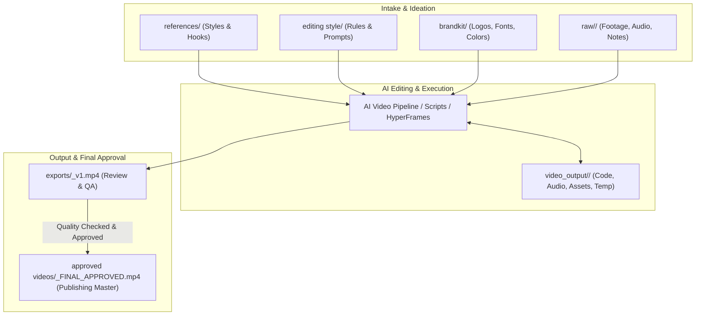

# 🎬 AI Video Editing Studio

Welcome to your AI Video Editing Studio workspace. This studio is organized for seamless end-to-end video creation—from raw footage ingestion and reference analysis to AI-assisted editing, styling, and final master delivery.

---

## 📁 Studio Architecture & Directory Structure

```
vibdecoding/
├── 📚 references/         # Benchmark videos, creator styles, and viral hooks you admire
├── 🏆 approved videos/    # Your gold-standard finished edits approved for publishing
├── 🎨 editing style/      # Editorial rules, LUTs, motion presets, caption styles, and prompt recipes
├── 💎 brandkit/           # Logos, brand color palette, fonts, audio stingers, and avatar assets
├── 📹 raw/                # Production hopper (one dedicated subfolder per video project)
├── 🚀 exports/            # Review staging area for rendered video versions (v1, v2) & thumbnails
├── ⚙️ video_output/       # (Automated) Isolated pipeline folders for code-rendered videos
└── 📜 GEMINI.md           # Universal Video Creation & Scripting Rules (Audience Empathy & Hypnotic Visuals)
```

---

## 🔄 The End-to-End Production Workflow



---

## 🎯 Quick Reference for Each Folder

| Folder | What Goes In It | Key Rule |
|---|---|---|
| [**`references/`**](file:///c:/Users/yashk/vibdecoding/references/README.md) | Viral clips, creator edits, pacing notes, and inspiration links | Study hook pacing (0–3s) and sound design |
| [**`approved videos/`**](file:///c:/Users/yashk/vibdecoding/approved%20videos/README.md) | Finished, high-bitrate master edits ready for distribution | The quality bar for future edits |
| [**`editing style/`**](file:///c:/Users/yashk/vibdecoding/editing%20style/README.md) | Style guide, caption rules, LUTs, and AI generation prompts | Keep visual change every 1.5–2.5s |
| [**`brandkit/`**](file:///c:/Users/yashk/vibdecoding/brandkit/README.md) | Logos, color hexes (`#FFDD00`, etc.), custom fonts, avatar cutouts | Single source of truth for branding |
| [**`raw/`**](file:///c:/Users/yashk/vibdecoding/raw/README.md) | New video source materials (camera, mic audio, B-roll, notes) | **One subfolder per video project!** |
| [**`exports/`**](file:///c:/Users/yashk/vibdecoding/exports/README.md) | Newly rendered versions (`_v1`, `_v2`), thumbnails, metadata | Review drafts before moving to approved |

---

## 🧠 Core Studio Principles (from `GEMINI.md`)

1. **🎯 Target Persona Emotional Resonance:** Every script and line must connect directly with the viewer's real-life struggle, dreams, and internal self-talk.
2. **👁️ Hypnotic Visuals & Sensory Metaphors:** Don't just tell—show sensory micro-moments that force the viewer's brain to vividly simulate the scenario.
3. **📁 Strict Project Isolation:** Any code-driven video engine must operate in its self-contained project directory inside `video_output/<project_slug>/`.

