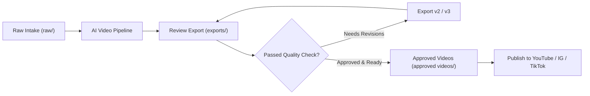

# 🚀 Video Exports & Deliverables (`exports/`)

This directory is the **review and distribution staging area**. All newly rendered video drafts, platform cuts, and export versions land here for final QA before publishing.

---

## 📂 What Goes in Here?

1. **Rendered Video Files:** MP4 and MOV exports generated from AI video tools (HyperFrames, Remotion, FFmpeg, Python scripts) or external NLEs (CapCut, Premiere, DaVinci).
2. **Multi-Platform Aspect Ratios:**
   - Vertical (`_9x16`): Optimized for Reels, Shorts, and TikTok.
   - Landscape (`_16x9`): Optimized for YouTube and web players.
   - Square (`_1x1`): Optimized for LinkedIn and Twitter feeds.
3. **Draft Iterations:** Versioned renders (`_v1`, `_v2`, `_vFinal`) so you can review changes without overwriting previous versions.
4. **Publishing Bundles:**
   - Thumbnails (`.png`, `.jpg` at 1280x720 or 1080x1920).
   - Video metadata packages (`caption.txt`, title options, hashtags, timestamps).

---

## 🏷️ Naming Convention

```
<project-slug>_<version>_<aspect-ratio>.<extension>
```

**Examples:**
* `ai-avatar-reel_v1_9x16.mp4`
* `ai-avatar-reel_v2_9x16.mp4`
* `hyperframes-deepdive_v1_16x9.mp4`
* `hyperframes-deepdive_thumb.png`
* `hyperframes-deepdive_metadata.txt`

---

## 🔄 Review & Approval Lifecycle



1. **Render:** When a video is compiled, output it to `exports/` with version `v1`.
2. **Review:** Check playback on phone and desktop (audio balance, caption sync, visual hooks).
3. **Iterate:** If tweaks are needed, render `v2`.
4. **Approve:** When ready for the world, copy or move the file to `approved videos/` as the final master!

